  <picture>
    <source media="(prefers-color-scheme: dark)" srcset="assets/banner-dark.svg">
    
  </picture>

  
  
  
  
  

I work on **feed-forward 3D/4D scene reconstruction**, with a focus on **dynamic Gaussian
representations**, **motion modeling**, and **efficient neural rendering**. My current research
investigates online dynamic scene reconstruction from monocular RGB video through persistent
4D Gaussian correction.

Computer Engineering undergraduate at **Hanbat National University** and undergraduate researcher
at **Visual Intelligence Lab (VILAB), Yonsei University**, advised by **Prof. Youngjung Uh**
(Sep. 2026 – Present). Previously at **UNIST Vision & Learning Lab** (3D hand pose and reconstruction)
and **AiRLab** (computer vision, image classification, and semantic segmentation).

---

## Currently

| TRACK | STATE |
| :--- | :--- |
| **Online Dynamic Scene Reconstruction via Persistent 4D Gaussian Correction** — refining persistent query and Gaussian representations with sequential monocular RGB observations | Ongoing research · Sep. 2026 – Present |
| **On-Device Human Pose Estimation for Real-Time Exercise Posture Assessment** — leading the AI pipeline; exercise-specific feedback from pose keypoints and joint-angle features | Capstone · Mar. 2026 – Present |

---

## Education

| Institution | Program | Period | GPA / Major GPA |
| :--- | :--- | :--- | :--- |
| **Hanbat National University** | B.S. Computer Engineering | Mar. 2025 – Present | 3.85 / 4.5 · 3.82 / 4.5 |
| **Pai Chai University** | B.S. Coursework, Software Engineering | Mar. 2021 – Dec. 2022 | 4.14 / 4.5 · 4.32 / 4.5 |

**Cumulative GPA (both institutions): 4.02 / 4.5 · Major GPA: 4.07 / 4.5**

## Research experience

| Lab | Focus | Period |
| :--- | :--- | :--- |
| **Visual Intelligence Lab (VILAB), Yonsei University**  Advisor: Prof. Youngjung Uh | Feed-forward 3D/4D scene reconstruction | Sep. 2026 – Present |
| **UNIST Vision & Learning Lab (UVLL)**  Advisor: Prof. Seungryul Baek | 3D hand pose estimation and 3D hand reconstruction | Mar. 2026 – Jun. 2026 |
| **Artificial Intelligence and Robotics Laboratory (AiRLab), Hanbat National University**  Advisor: Prof. Dong-Geol Choi | Computer vision, image classification, semantic segmentation | Jun. 2025 – Mar. 2026 |

---

## Projects

| Project | What it is |
| :--- | :--- |
| **Exercise3D Multi-View Dataset Pipeline**  Aug. 2026 – Sep. 2026 | Completed a triple-camera exercise-video pipeline for camera poses, 3D joints, and parametric body fits using audio/PTS synchronization, fixed-camera bundle adjustment, and multi-view triangulation. **26 sequences / 78 videos / 65,595 frames**, with per-frame quality validation |
| [**satellite-building-segmentation**](https://github.com/06-month/satellite-building-segmentation)  Jan. 2026 – Feb. 2026 | Building-region semantic segmentation from satellite imagery; AiRLab coding seminar |
| [**CLIP2FL_BKD**](https://github.com/06-month/CLIP2FL_BKD)  Oct. 2025 – Dec. 2025 | Balanced knowledge distillation on top of CLIP2FL for long-tail federated learning. Resulted in a KICS Winter Conference 2026 publication |
| [**Satellite-Cloud-Semantic-Segmentation**](https://github.com/06-month/Satellite-Cloud-Semantic-Segmentation)  Nov. 2025 – Dec. 2025 | Three-class cloud segmentation from satellite imagery — thick cloud, thin cloud, cloud shadow |
| [**Offline-to-Online-RL**](https://github.com/06-month/Offline-to-Online-Reinforcement-Learning) | Online fine-tuning of offline-pretrained RL policies |
| [**Budgetly**](https://github.com/06-month/HBNU-SWUNIV-ossw-competition25-yee) | OCR-based personal finance web app. 1st place, HBNU Open Source Software Utilization Competition 2025 |

---

## Paper reviews

Read-throughs I write myself, working from the paper rather than summarising it.

[3D Gaussian Splatting](https://archive-06.vercel.app/blog/3d-gaussian-splatting-for-real-time-radiance-field-rendering-%EB%A6%AC%EB%B7%B0) ·
[NeRF](https://archive-06.vercel.app/blog/nerf-representing-scenes-as-neural-radiance-fields-for-view-synthesis-%EB%A6%AC%EB%B7%B0) ·
[Deformable 3D-GS](https://archive-06.vercel.app/blog/deformable-3d-gaussians-for-high-fidelity-monocular-dynamic-scene-reconstruction-%EB%A6%AC%EB%B7%B0) ·
[4D-GS](https://archive-06.vercel.app/blog/4d-gaussian-splatting-for-real-time-dynamic-scene-rendering-%EB%A6%AC%EB%B7%B0) ·
[pixelSplat](https://archive-06.vercel.app/blog/pixelsplat-3d-gaussian-splats-from-image-pairs-for-scalable-generalizable-3d-reconstruction-%EB%A6%AC%EB%B7%B0) ·
[**all reviews →**](https://archive-06.vercel.app/blog)

---

## Publication

**Balanced Knowledge Distillation (BKD) for Long-Tail Federated Learning Based on CLIP2FL**
<samp>Jun Jeon</samp>, Minu Baek, Sangkeum Lee† — *KICS Winter Conference, 2026*

## Awards & Honors

**1st Place — Open Source Software Utilization Competition**, Hanbat National University · Nov. 2025

Budgetly, an OCR-based financial management web application.

---

## Wiki

A linked wiki over the papers I work through — 135+ LLM-generated entries on 3D representation,
rendering, and the geometry behind them, which I curate as I read. It is a map of the literature,
not my own writing.

[3D Gaussian Splatting](https://archive-06.vercel.app/wiki/3d-gaussian-splatting) ·
[NeRF](https://archive-06.vercel.app/wiki/nerf) ·
[4D Scaffold-GS](https://archive-06.vercel.app/wiki/4d-scaffold-gs) ·
[MoSca](https://archive-06.vercel.app/wiki/mosca) ·
[ATSplat](https://archive-06.vercel.app/wiki/atsplat) ·
[**full map →**](https://archive-06.vercel.app/wiki-map)

---

## Stack

  
  
  
  
   
  
  
  
  
  
   
  
  
  
  

Working knowledge: 3D Gaussian Splatting · novel view synthesis · multi-view and camera geometry · COLMAP · semantic segmentation

AWS Certified Cloud Practitioner (CLF-C02) · Naver Cloud Platform Certified Associate (NCA) · TOEIC 800

**Relevant coursework:** Artificial Intelligence (A+) · Computer Vision (A+) ·
Reinforcement Learning (A+) · Metaverse and Digital Space Theory (A+)

---

  <picture>
    <source media="(prefers-color-scheme: dark)" srcset="https://raw.githubusercontent.com/06-month/06-month/output/snake-dark.svg">
    <source media="(prefers-color-scheme: light)" srcset="https://raw.githubusercontent.com/06-month/06-month/output/snake.svg">
    
  </picture>

